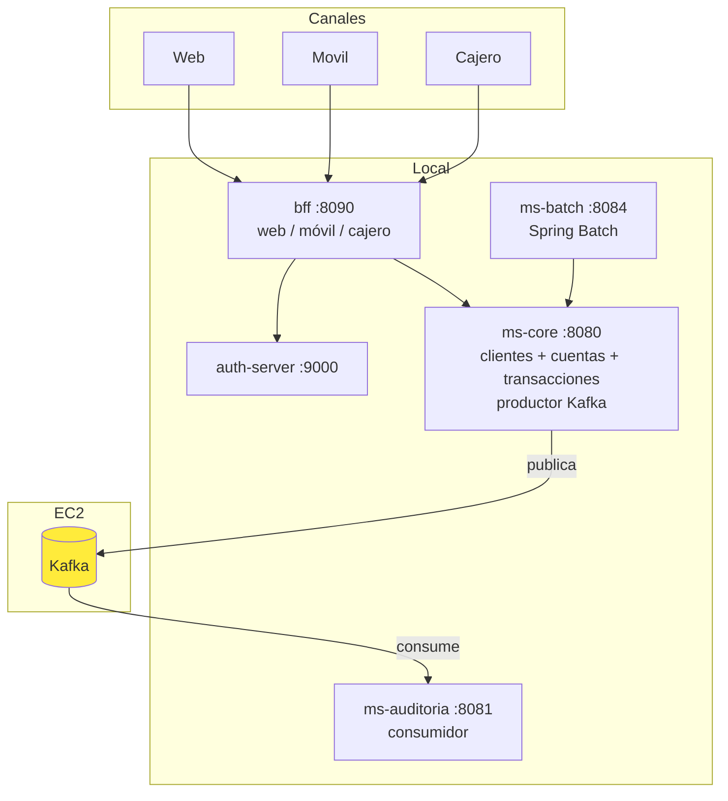

# Arquitectura Final - BancoXYZ 

**Fecha:** 2026-10-09  
**Versión:** Final reducida  
**Despliegue:** Microservicios locales + Kafka en instancia EC2.

---

## Componentes finales

| Servicio | Puerto | Origen | Rol |
|----------|--------|--------|-----|
| **auth-server** | 9000 | bancoxyz-kafka | Authorization Server OAuth2 (JWT) |
| **ms-core** | 8080 | ms-transacciones | Clientes + Cuentas + Transacciones. Productor Kafka + Resilience4j + Resource Server |
| **ms-auditoria** | 8081 | bancoxyz-kafka | Consumidor Kafka + alertas (recomendado) |
| **ms-batch** | 8084 | bancoxyz | Spring Batch (transacciones diarias, intereses mensuales, estados de cuenta) |
| **bff** | 8090 | bancoxyzBFF | BFF unificado (canales `/api/web`, `/api/movil`, `/api/cajero`) |
| **Kafka** | 29092 | docker-compose | Mensajería asíncrona (**EC2**) |

## Diagrama

## Cumplimiento de requisitos

- **Spring Batch**: `ms-batch` (jobs, fault tolerance, skip policy, paralelismo).
- **BFF 3 canales**: `bff` unificado con endpoints diferenciados.
- **Kafka productor + consumidor**: `ms-core` + `ms-auditoria`.
- **Resilience4j**: ya implementado en productor y consumidor.
- **OAuth2 / Seguridad**: `auth-server` + Resource Servers.
- **Mínimo de servicios**: 4 servicios de aplicación + Kafka externo.

## Despliegue

- Kafka: `docker-compose.kafka-ec2.yml` en EC2 (ajustar `PUBLIC_IP`).
- Resto: `mvn spring-boot:run` local, apuntando `KAFKA_BOOTSTRAP_SERVERS` a la IP de la EC2.

